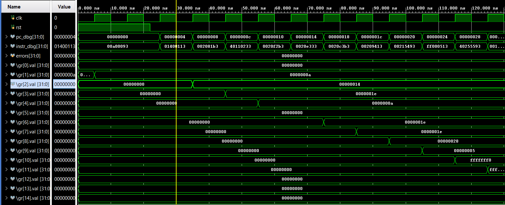

# RISC-V Single-Cycle Processor (RV32I)

A clean, modular implementation of a 32-bit Single-Cycle RISC-V Processor (RV32I base integer instruction set) written in Verilog HDL and simulated using AMD/Xilinx Vivado.

---

## 🏗️ Architectural Overview

The processor implements the standard RV32I datapath and control unit, consisting of the following modular units:
* **Program Counter (`pc_reg`)**: Manages instruction address sequencing (`PC + 4` or branch/jump targets).
* **Instruction Memory (`instr_mem`)**: Asynchronous read ROM initialized via `$readmemh` with `program.hex`.
* **Control Unit (`control`)**: Decodes instruction opcodes to generate ALU, memory, and register write control signals.
* **Immediate Generator (`imm_gen`)**: Extracts and sign-extends immediate values for I, S, B, and U-type instructions.
* **Register File (`regfile`)**: 32 x 32-bit general-purpose registers (`x0` hardwired to zero, asynchronous read, synchronous write).
* **ALU & ALU Control (`alu`, `alu_control`)**: Performs arithmetic, logic, and comparison operations.
* **Branch Unit (`branch_unit`)**: Evaluates branch conditions (BEQ, BNE, BLT, BGE, etc.).
* **Data Memory (`data_mem`)**: Synchronous write, asynchronous/synchronous read RAM for data storage.

---

## 📊 Simulation Waveforms

Below is the simulation waveform captured from Vivado (`xsim`), demonstrating correct instruction fetching (`pc_dbg`, `instr_dbg`), clock toggling (`clk`), and successful register updates (`gr[1]`, `gr[2]`, `gr[3]`, etc.) executing test instructions:



---

## 🚀 Getting Started & Simulation (Vivado)

1. Clone or download this repository.
2. Open **AMD Vivado** and create a new RTL project.
3. Add all source files from `rtl/`, testbench from `tb/`, and simulation files from `sim/`.
4. Ensure `program.hex` is accessible in your simulation working directory (or update the path in `instr_mem.v`).
5. Set `tb_riscv_single_cycle` as the top module and launch behavioral simulation in Vivado XSIM.

---

## 📁 Repository Structure
```text
riscv_single_cycle/
├── rtl/
│   ├── alu.v
│   ├── alu_control.v
│   ├── branch_unit.v
│   ├── control.v
│   ├── data_mem.v
│   ├── imm_gen.v
│   ├── instr_mem.v
│   ├── pc_reg.v
│   ├── regfile.v
│   └── riscv_single_cycle.v
├── tb/
│   └── tb_riscv_single_cycle.v
├── sim/
│   ├── program.hex
│   ├── program.s
│   └── run.sh
├── tools/
│   └── assemble.py
├── images/
│   └── waveform.png
└── README.md
```

## 📜 License
This project is open-source and available under the MIT License.
